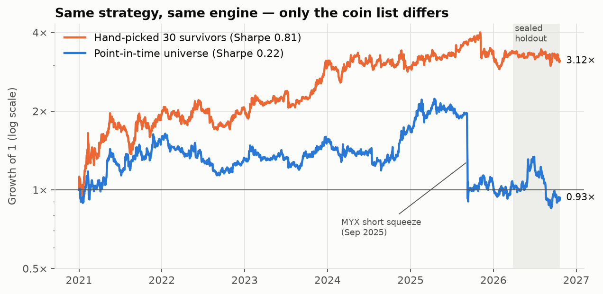
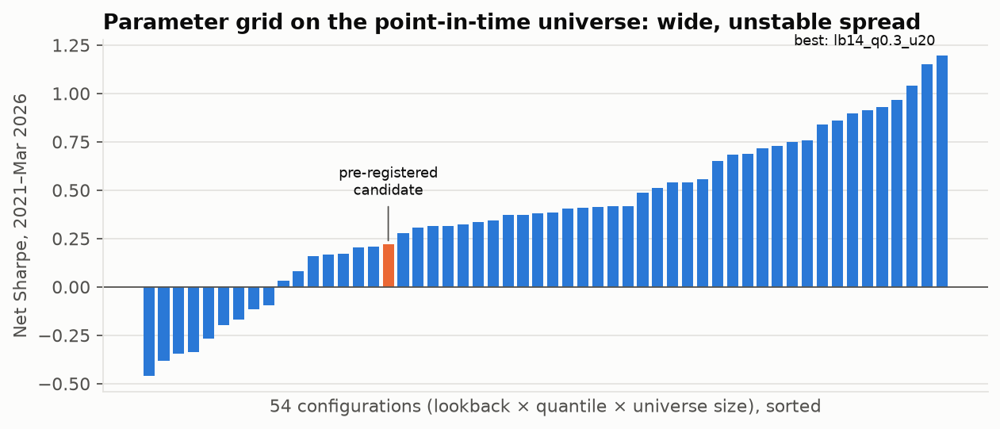
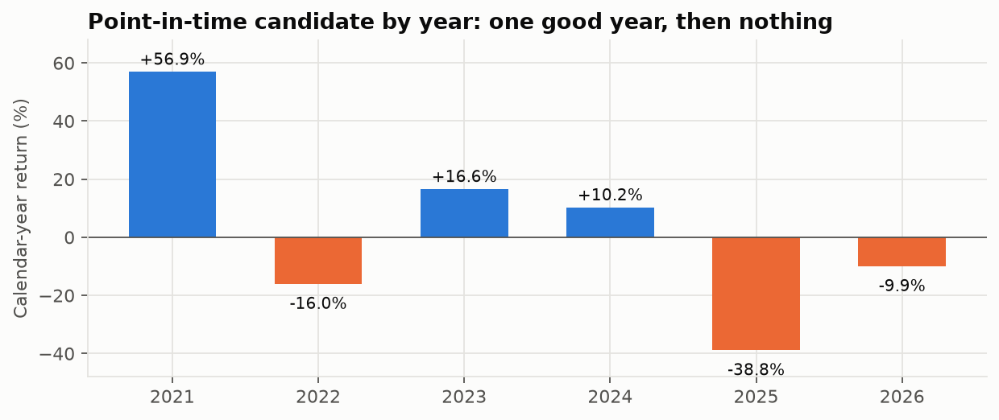
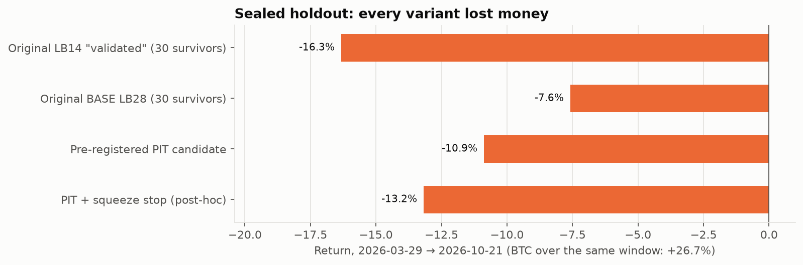

# Survivorship Is the Strategy: A Pre-Registered Audit of Cross-Sectional Momentum in Crypto Perpetual Futures

**Author:** ayushk2s · **Date:** October 2026 · **Code & data pipeline:** this repository

---

## Abstract

We audit a cross-sectional momentum (XSMOM) strategy on crypto perpetual futures whose initial backtest
reported a Sharpe ratio of 0.68–0.90 and a CAGR of 17–24% over 2021–2026. A skeptical review of that
backtest found that the "validated" configuration had been selected using its own holdout period, that
results depended on which weekday the portfolio was rebalanced, and that the 30-coin universe consisted
only of coins still trading in 2026. We then rebuilt the pipeline on a point-in-time (PIT) universe of 892
Binance USDT-M perpetuals, including delisted contracts, with drift-aware holdings, a liquidity-scaled cost
model, staggered rebalancing tranches, and 14 deployment gates written down before any new result was
seen. The same strategy that earns a Sharpe of 0.81 on the hand-picked survivors earns **0.22 (t = 0.51)
with a −59.5% maximum drawdown** on the PIT universe. It fails 8 of 14 gates, including Deflated Sharpe
(0.04), probability of backtest overfitting (0.45) and rolling walk-forward (Sharpe −0.15). On a sealed
seven-month holdout (2026-03-29 → 2026-10-21) that no part of the design had touched, every variant lost
money (−7.6% to −16.3%) while Bitcoin rose 26.7%. We conclude that the apparent edge came from the choice
of universe, not from momentum, and we release the pipeline as a reusable template for testing crypto
cross-sectional strategies.

---

## 1. Introduction

Momentum, buying recent winners and selling recent losers, is one of the most studied return anomalies in
equities (Jegadeesh & Titman, 1993), and momentum has also been documented in cryptocurrency returns
(Liu, Tsyvinski & Wu, 2022). It is therefore a natural first strategy to try in crypto, where perpetual
futures make both long and short legs cheap to hold.

Crypto is also an unusually dangerous place to backtest a cross-sectional strategy:

- **The universe changes constantly.** Hundreds of contracts have been listed and delisted since 2020.
  A list of "the top 30 coins" made today silently excludes every coin that collapsed or was delisted (LUNA, SRM,
  EOS, …) and includes coins whose later success is what put them on the list.
- **Tails are extreme.** Single contracts can rise more than 10× in days, which is fatal for an unhedged short.
- **Sample length is short.** Five years of daily data covers roughly two market cycles.

This paper documents what happened when one such strategy was put through a full pre-deployment
review. The contribution is less the negative result itself than the size of the gap between the
naive and the corrected backtest, and the procedure used to measure it.

## 2. Strategy specification

At each rebalance date the strategy:

1. Takes the eligible universe (Section 3) and computes each contract's trailing *L*-day return.
2. Goes long the top quantile *q* and short the bottom quantile *q*.
3. Weights names within each leg by inverse 20-day volatility; each leg carries 50% of capital
   (1.0× gross, dollar-neutral).
4. Holds for 7 days.

The original build also included a "funding-crowding tilt" that scaled down longs in names with very
positive funding (and shorts in names with very negative funding). Sweeping its strength from 0 to 1 changed
the Sharpe ratio by less than 0.02, so it was removed from the corrected specification.

**Pre-registered candidate (corrected pipeline):** *L* = 28 days, *q* = 0.20, top-30 universe, 60-day minimum
listing history, weekly rebalancing split into 7 daily tranches, trading at the close of the signal bar.

## 3. Data

| | Original build | Corrected build |
|---|---|---|
| Instruments | 30 Binance USDT pairs, spot 1-minute bars resampled to daily | All Binance USDT-M perpetuals: **892 contracts** |
| Universe rule | Fixed list of coins trading in 2026 | Monthly-updated top-*N* by trailing 30-day median quote volume, computed only from past data |
| Delisted contracts | None | Included; 10 top-30 members stopped trading before 2026-03 (LUNA, SRM, EOS, HNT, COCOS, FRONT, TOMO, YFII, and renamed MATIC, RNDR) |
| Funding | REST API, 30 symbols | Binance public archive + REST, **508 contracts** that ever ranked top-60 by volume |
| Period | 2021-01-01 → 2026-03-28 | Research: 2021-01-01 → 2026-03-28 · **Sealed holdout: 2026-03-29 → 2026-10-21** |

Source: `data.binance.vision` monthly archives (which retain delisted symbols), topped up from the
`fapi.binance.com` REST API for the current month. Over the research period, 225 distinct contracts passed
through the top-30 universe at some point. Sanity checks: no duplicate bars, no non-positive prices, and BTC
perpetual closes match the original spot data to a median absolute difference of 0.05%.

## 4. Stage 1 — audit of the original backtest

The original repository reported Sharpe 0.68 / CAGR 17.1% / max drawdown −35.9% for *L* = 28 and Sharpe 0.90 /
CAGR 24.0% / max drawdown −24.8% for a "validated" *L* = 14. All reported metrics reconciled when recomputed
from the saved return series, apart from a non-standard Sortino ratio. The problems were in the design of
the tests, not the arithmetic.

**4.1 The holdout was used for selection.** The *L* = 14 configuration was documented as having "held up
out-of-sample", but the only out-of-sample script ever ran *L* = 28. *L* = 14 was simply the best row of a
19-configuration sweep run over the *full* 2021–2026 period. On the development period alone (2021–2023) it
ranked **17th of 19** (Sharpe 0.60). Selecting honestly on 2021–2023 picks *L* = 42 (Sharpe 1.05), which then
earns 0.30 out-of-sample. Development-period rank and out-of-sample rank were *negatively* correlated
(Spearman ρ = −0.17).

**4.2 The "walk-forward" had no refit.** It was a single frozen configuration cut into three periods:
Sharpe 0.94 (2021–23) → 0.15 (2024) → 0.41 (2025–26).

**4.3 Weak statistics.** For *L* = 28: t-statistic 1.55; 95% Sharpe confidence interval [−0.19, 1.55]
(Mertens 2002 standard error, adjusted for skew −0.67 and kurtosis 13.7). Without the 10 best days, total
log P&L fell from 0.83 to 0.17; without the best 20 days, it turned negative. 2023 alone produced +72.5%.

**4.4 Hidden parameters.** Changing only the weekday the portfolio was rebalanced moved the Sharpe ratio from
0.39 to 0.90 (*L* = 28) and from 0.41 to 1.24 (*L* = 14).

**4.5 Engineering issues.**
- `pandas.pct_change()` forward-fills missing prices by default, so a stopped contract (MATIC after its
  2024 rename) looked like a flat, eligible asset.
- Weights were held constant between rebalances, which implicitly rebalances every day at zero cost.
- Monte Carlo and permutation logs were empty.
- The project's virtual environment had no packages installed, so the published numbers could not be
  reproduced as committed.

## 5. Corrected methodology

### 5.1 Engine (`src/pit_engine.py`)

- **Point-in-time universe.** At each rebalance, contracts are ranked by trailing 30-day median quote volume,
  using only data available at that time, among those with at least 60 days of history.
- **No forward-filling.** A held contract that stops trading is force-closed at its last price, and the
  trade pays costs.
- **Drifting holdings.** Positions drift with prices between rebalances, and costs are charged on the actual
  traded notional against the drifted book.
- **Cost model**, per side, scaled by a stress multiplier:
  - 5 bp taker fee;
  - half-spread of 2 bp × √(100M / ADV$), clipped to [0.5, 25] bp;
  - square-root market impact (cf. Almgren et al., 2005) of 0.7 · σ_daily · √(order$ / ADV$), sized to the
    tranche's capital (default $100k total).
- **Funding** is applied from real 8-hour rates to positions held over each funding timestamp.
- **Tranches.** Capital is split into 7 sleeves that rebalance weekly on different weekdays, which removes
  the weekday-choice parameter.
- **Execution lag** is explicit: the signal uses data through close[*t* − lag] and the trade fills at close[*t*].

### 5.2 Pre-registration and sealed holdout

Before any PIT result was computed, we wrote down the candidate configuration, the research/holdout split,
the cost model, and 14 pass/fail gates with numeric thresholds
([`reports/DEPLOYMENT_GATES.md`](../reports/DEPLOYMENT_GATES.md)). The validation script then:

1. ran on research data only;
2. froze the configuration and a SHA-256 hash of its research returns to `reports/frozen_config.json`.

The holdout script refuses to run without the frozen file, checks the hash, and evaluates the frozen
configuration on the holdout exactly once.

### 5.3 Tests

| Test | Implementation |
|---|---|
| Significance | t-statistic; Sharpe 95% CI with skew/kurtosis-adjusted standard error (Lo 2002; Mertens 2002) |
| Multiple testing | Deflated Sharpe Ratio (Bailey & López de Prado, 2014) with N = 100 trials (54-config grid + 19 earlier sweep + undocumented earlier rounds) |
| Overfitting | Probability of Backtest Overfitting via combinatorially symmetric cross-validation, 16 blocks, 12,870 splits (Bailey et al., 2017) |
| Out-of-sample | Rolling walk-forward: refit quarterly on trailing 2 years over the 54-config grid, 2023-01 → 2026-03 |
| Benchmark | 100 random-name portfolios with the same dates, name counts, weighting and costs |
| Robustness | 2×/3× costs; +1 day execution delay; capacity at $1M/$10M/$50M; one-step parameter neighbours; per-weekday sleeves; long-only and short-only legs |
| Risk | 20-day block bootstrap of 1-year paths (10,000 paths) at 0.5×–3× gross leverage |
| Reproducibility | Deterministic re-run with pinned dependencies |

## 6. Results

### 6.1 The universe effect



*Figure 1. Same engine and same parameters (L = 28, q = 0.20, 1 tranche, 1-day lag, as in the original build).
Orange: the original 30 hand-picked coins. Blue: pre-registered PIT candidate (7 tranches, lag 0). Shaded: sealed holdout.*

| Universe (same engine, research period) | Net Sharpe |
|---|---|
| Original 30 survivors — original settings (1 tranche, 1-day lag) | **0.81** |
| Original 30 survivors — 7 tranches, no lag | **1.08** |
| **PIT top-30 (pre-registered candidate)** | **0.22** |
| PIT top-30, 365-day minimum history | 0.28 |
| PIT top-50 | 0.41 |
| PIT top-20 | −0.12 |
| Top-30 frozen as of 2020-12-31 (no hindsight, no updates) | 0.08 |

The only change between the first rows and the PIT rows is how the coin list is chosen. P&L attribution on
one sleeve makes the mechanism explicit: positions in the 30 survivor names contributed **+1.55** (cumulative
position-weighted return, 1.0 = 100% of sleeve capital), while all other names contributed **−2.38**. The
largest contributors were SOL (+0.36), AVAX (+0.22) and XRP (+0.20), all on the survivor list. These coins are on a 2026 list precisely because of the returns the backtest then "discovers".

### 6.2 Gate results

| Gate | Threshold | Result | Value |
|---|---|---|---|
| G1 Net Sharpe | ≥ 0.70 | **FAIL** | 0.22 (CAGR 0.9%, max DD −59.5%) |
| G2 t-statistic | ≥ 2.0 | **FAIL** | 0.51; 95% CI [−0.65, 1.09] |
| G3 Deflated Sharpe, N = 100 | ≥ 0.95 | **FAIL** | 0.036 (expected max Sharpe of 100 null trials: 1.02) |
| G4 PBO | ≤ 0.30 | **FAIL** | 0.45 |
| G5 Walk-forward OOS Sharpe | ≥ 0.50 | **FAIL** | −0.15 |
| G6 Cost stress 2× / 3× | ≥ 0.5 / > 0 | **FAIL** | 0.11 / −0.01 |
| G7 +1 day latency keeps ≥ 60% | ≥ 60% | PASS | 0.37 vs 0.22 (both ≈ 0) |
| G8 Stability | no year > 50% of P&L; ≥ 4/6 years positive | **FAIL** | all net P&L from 2021; 2025 −38.8% |
| G9 Random-name benchmark | p < 0.05 | PASS (weak) | p = 0.010; null mean −0.78 is cost-driven |
| G10 Parameter neighbourhood | ≥ 70% of neighbours ≥ ½ candidate | PASS (trivial) | 83%, but ½ × 0.22 is a near-zero bar |
| G11 Sealed holdout | not below 5th pct of bootstrap | PASS (low power) | −10.9%, 25th percentile |
| G12 Capacity | $1M drop ≤ 0.10 | PASS | 0.17 at $1M; 0.03 at $10M |
| G13 Risk | P(1y DD > 30%) ≤ 10% at chosen leverage | **FAIL** | 16% even at 0.5×; 35.6% at 1× |
| G14 Reproducibility | bit-identical re-run | PASS | max diff 0 |

**8 FAIL, 6 PASS.** Four of the passes are uninformative: G7 compares two near-zero Sharpe ratios, G9's
random portfolios mostly lose to their own higher turnover, G10's threshold scales with a near-zero
candidate, and G11 has little power over seven months.

### 6.3 The parameter grid



*Figure 2. Net Sharpe of all 54 configurations on the PIT universe, research period.*

The grid ranges from −0.46 to 1.19 (median 0.38). A best-in-grid Sharpe of 1.19 is close to what pure chance
would produce: the Deflated Sharpe calculation puts the expected maximum of 100 skill-less trials at 1.02.
The rolling walk-forward confirms this. Re-selecting the best trailing-two-year configuration every quarter
produced an out-of-sample Sharpe of **−0.15**, and the chosen configuration changed 10 times across 13 quarters.

### 6.4 Where the losses come from

- **The short leg.** Long leg alone: Sharpe 0.44, CAGR 10.2% (largely market beta). Short leg alone: Sharpe
  −0.29, **CAGR −29.6%**. Crypto "losers" are disproportionately candidates for violent short squeezes.
- **One squeeze can dominate.** MYX rose from $0.11 (July 2025) to $16.78 (September 2025). The strategy
  held it short as a bottom-quintile name going into a move from $1.16 to $14.48 over four days. That single
  position cost one sleeve **−162%** of its capital and accounts for the step in Figure 1.
- **Regimes.** Sharpe by BTC 90-day trend: bear −0.51, chop −0.40, bull 1.33. The strategy is
  market-neutral in beta (correlation to BTC −0.09) but not in outcome: it works only in bull markets.



*Figure 3. Calendar-year returns of the PIT candidate (2026 includes the holdout).*

### 6.5 Risk

20-day block bootstrap, 1-year horizon, 10,000 paths (research-period returns):

| Gross leverage | Median 1y return | 5th pct | P(loss) | P(DD > 30%) | P(DD > 50%) |
|---|---|---|---|---|---|
| 0.5× | +5% | −27% | 39% | 16.0% | 0.8% |
| 1.0× | +7% | −51% | 42% | 35.6% | 16.5% |
| 2.0× | +2% | −85% | 49% | 89.9% | 42.3% |
| 3.0× | −13% | −98% | 56% | 99.5% | 78.3% |

No leverage level meets the pre-registered risk gate.

### 6.6 A post-hoc fix (not counted toward the gates)

Because the MYX loss is a known failure mode, we tested a squeeze stop *after* seeing the results: close any
position whose weight drifts beyond 2× its target. This lifts the research Sharpe to 0.59 (t = 1.35; 0.46 at
2× costs) and cuts the max drawdown to −30.3%. It is still not significant, and because it was added after
seeing the data it carries its own selection bias.

### 6.7 Sealed holdout



*Figure 4. Returns over the sealed holdout, 2026-03-29 → 2026-10-21 (207 days).*

| Variant | Research Sharpe | Holdout return | Holdout Sharpe |
|---|---|---|---|
| Original *L* = 14 "validated" (30 survivors) | 0.98 | **−16.3%** | −1.28 |
| Original *L* = 28 (30 survivors) | 0.81 | **−7.6%** | −0.53 |
| Pre-registered PIT candidate | 0.22 | **−10.9%** | −0.33 (max DD −36.6%) |
| Walk-forward's last pick (*L* = 14, *q* = 0.2, top-50) | — | **−11.8%** | −0.74 |
| PIT + squeeze stop (post-hoc) | 0.59 | **−13.2%** | −0.46 |

Bitcoin returned +26.7% over the same window. The pre-registered candidate's −10.9% sits at the 25th
percentile of the research-implied distribution (5th–95th: −45.9% to +51.5%), so G11 technically passes.
That distribution is so wide that seven months cannot statistically confirm or reject anything on their own.
What matters is that the highest-Sharpe variants from the research period did worst out-of-sample.

## 7. Discussion

**Why the original result looked real.** Each of the original flaws pushed in the same direction:
- a universe built with hindsight;
- a configuration chosen using the holdout;
- a lucky rebalance weekday;
- free daily rebalancing.

None of them would have been visible from the equity curve. Each step of the correction removed some of the
apparent edge, and the universe correction alone removed most of it (Sharpe 0.81 → 0.22).

**Is momentum in crypto therefore absent?** This study does not show that. It shows that *this
implementation* — weekly, dollar-neutral, top-30 by volume, inverse-volatility, unhedged shorts — has no
edge that survives realistic construction. Long-only or time-series formulations, which avoid the
squeeze-prone short leg, remain open questions. They would need to be tested as new, pre-registered
hypotheses rather than as repairs to this one.

**Lessons for crypto backtests.**
1. Build the universe point-in-time and include delisted contracts before looking at any result.
   In this study that single correction was worth about 0.6–0.9 Sharpe.
2. Treat the rebalance phase as a parameter, or remove it with tranches.
3. Write gates and freeze configurations before opening data you intend to use as a holdout, and enforce
   the freeze in code.
4. Count trials honestly; Deflated Sharpe with a realistic N is a fast sanity check.

## 8. Limitations

- **Costs are modelled, not measured.** The spread and impact coefficients are assumptions; they mostly
  matter for G6 and G12, and the strategy fails G1–G5 even at zero additional stress.
- **Daily-close execution** ignores intraday path and funding-timestamp precision.
- **The holdout is short** (207 days) and has low statistical power, as discussed above.
- **The universe is limited to Binance perpetuals.** Contracts listed only on other venues are not covered.
- **Some results hinge on single events.** MYX dominates one sleeve's losses; with tranching its effect on the
  ensemble is diluted, but a different tail event could change the year-level picture.
- **The search was limited.** The grid covers three parameters; volatility lookback and holding period were
  held fixed after the earlier sweep showed low sensitivity.

## 9. Conclusion

A momentum strategy that looked deployable — Sharpe up to 0.90, CAGR up to 24% — turns out to be explained
by universe selection with hindsight and by choosing the configuration on its own holdout. On a
point-in-time universe with realistic costs it earns a Sharpe of 0.22 with a −59.5% drawdown, fails 8 of
14 pre-registered gates, and every variant lost money on seven months of unseen data. The strategy should
not be deployed. The pipeline — point-in-time data including delisted contracts, a corrected engine,
pre-registered gates and an enforced sealed holdout — is the reusable output of this work.

## Reproducibility

```bash
python -m venv .venv && .venv/Scripts/pip install -r requirements.txt   # Windows; use .venv/bin on Linux/macOS
python scripts/fetch_pit_futures.py    # ~10 min, downloads ~27 MB of daily klines + funding
python scripts/validate_pit.py         # research-period gates, freezes reports/frozen_config.json (~2 min)
python scripts/holdout_test.py         # opens the sealed holdout once
python scripts/make_figures.py         # regenerates docs/figures/
```

Logs from the runs reported here are in `reports/pit/`.

## References

- Almgren, R., Thum, C., Hauptmann, E., & Li, H. (2005). Direct estimation of equity market impact. *Risk*, 18(7).
- Bailey, D. H., & López de Prado, M. (2014). The Deflated Sharpe Ratio: Correcting for selection bias, backtest overfitting and non-normality. *Journal of Portfolio Management*, 40(5).
- Bailey, D. H., Borwein, J., López de Prado, M., & Zhu, Q. J. (2017). The probability of backtest overfitting. *Journal of Computational Finance*, 20(4).
- Brown, S. J., Goetzmann, W., Ibbotson, R. G., & Ross, S. A. (1992). Survivorship bias in performance studies. *Review of Financial Studies*, 5(4).
- Harvey, C. R., Liu, Y., & Zhu, H. (2016). … and the cross-section of expected returns. *Review of Financial Studies*, 29(1).
- Jegadeesh, N., & Titman, S. (1993). Returns to buying winners and selling losers. *Journal of Finance*, 48(1).
- Liu, Y., Tsyvinski, A., & Wu, X. (2022). Common risk factors in cryptocurrency. *Journal of Finance*, 77(2).
- Lo, A. W. (2002). The statistics of Sharpe ratios. *Financial Analysts Journal*, 58(4).
- Mertens, E. (2002). Comments on variance of the IID estimator in Lo (2002). Working paper, University of Basel.

---

*This document is research, not investment advice. Nothing here is a recommendation to trade any instrument.*
